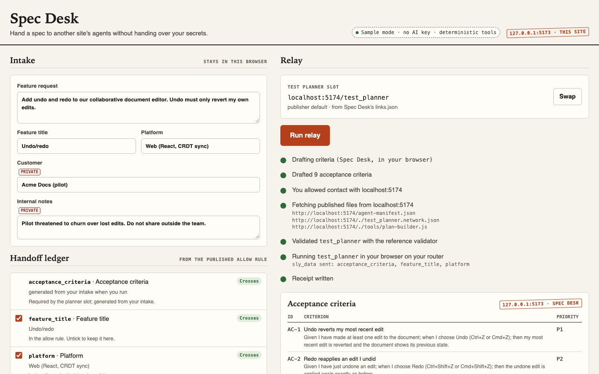
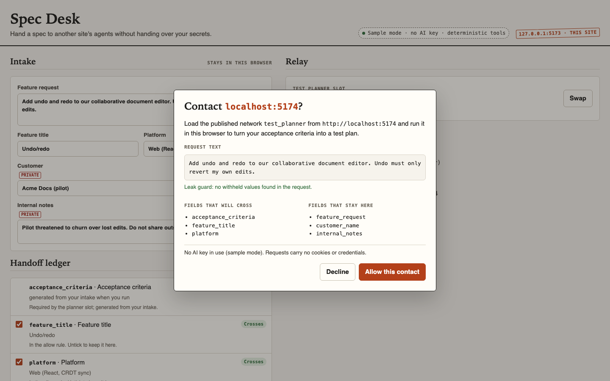
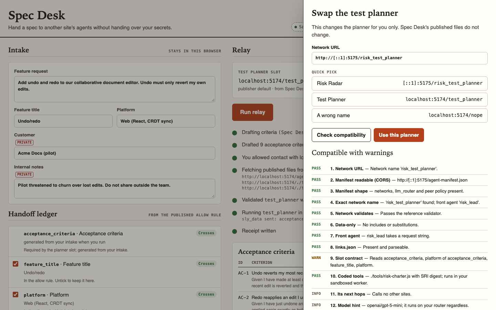
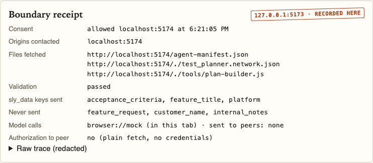

# Spec Relay

> Hand a spec to another site's agents without handing over your secrets, then swap that site out by URL.



Spec Relay is three independent open agentic websites, built on the
[Worldwide Agentic Web MVP spec (Profile 0.3)](https://raw.githubusercontent.com/cognizant-ai-labs/agentic-web/main/docs/worldwide_agentic_web_mvp_spec.md) and its
unmodified reference browser runtime:

| Site | Local origin | Published network | What it does |
| --- | --- | --- | --- |
| **Spec Desk** | `http://127.0.0.1:5173` | `spec_desk` | Turns a feature request into acceptance criteria, then calls a test planner through a link slot |
| **Test Planner** | `http://localhost:5174` | `test_planner` | Turns acceptance criteria into a case-by-case test matrix |
| **Risk Radar** | `http://[::1]:5175` | `risk_test_planner` | A drop-in alternative planner: risk matrix and exploratory charters |

## The problem

A product engineer has a feature request plus context that must not leave the team: the
customer's name and internal notes. They want acceptance criteria and a test plan. Today they
paste everything into whichever AI tool is open, and they can't change that tool without
re-integrating it.

## What it does

1. **Spec Desk drafts source-linked requirements and suggested acceptance checks in your browser.** The front agent delegates to `criteria_writer`, which calls a sandboxed coded tool. You edit and approve the criteria before the separate planner phase starts. The consent card contains the actual approved criteria payload.
2. **Spec Desk loads Test Planner's *published* agent network from another origin** and runs it
   locally, on your own model router. A consent card names the origin and the purpose, and shows
   the exact request text, before anything is fetched from that origin.
3. **A handoff ledger shows which fields cross.** The runtime's published
   `allow.to_downstream.sly_data` rule permits the generated criteria and your selected title and
   platform. It excludes the customer name and internal notes from the peer's structured context.
4. **A boundary receipt records the handoff.** It lists the peer origin and public files read,
   validation, the `sly_data` keys passed to the locally running planner, and the active router.
   The planner's result reports the keys its coded tool received.
5. **Swap the planner by URL.** A slot-contract compatibility checker reads the candidate's public
   files (it asks first, and runs nothing). If the candidate passes, your choice is stored in this
   browser only. The next run uses Risk Radar on a third origin, a network with a different shape,
   and Spec Desk's code and published files don't change.



## The demo moment

Click **Run relay**, review the suggested checks, then **Approve and plan**. The consent card asks to contact `localhost:5174`. Click **Allow** and the
timeline shows the manifest, network definition, link map and tool bundle being fetched. The
runtime validates the network and executes it in your browser.
The test plan card is stamped `localhost:5174` and says "Fields it received: acceptance_criteria,
feature_title, platform". Then click **Swap**, pick Risk Radar, run **Check compatibility**, then
**Use this planner** and run again. This time the consent card names `[::1]:5175`, and a risk
matrix comes back from a different site.



| Boundary receipt | Risk Radar's result after the swap |
| --- | --- |
|  | ![Risk matrix and charters stamped [::1]:5175](docs/images/risk-plan.png) |

## How it works

```mermaid
flowchart LR
  subgraph Browser["Visitor's browser (tab on 127.0.0.1:5173)"]
    UI[Spec Desk page<br/>ledger · consent card · receipt]
    RT[Reference nsDeploy runtime<br/>vendored, unmodified]
    SB[Sandboxed worker<br/>coded tools, no network]
    UI -->|engine.runTurn + slyData| RT
    RT --> SB
  end
  RT -->|own manifest, network, links.json| A[(127.0.0.1:5173<br/>Spec Desk)]
  RT -. "after consent: manifest, network, links, tools (CORS, no credentials)" .-> B[(localhost:5174<br/>Test Planner)]
  RT -. "after swap + consent" .-> C[(&#91;::1&#93;:5175<br/>Risk Radar)]
  RT -->|model calls only| R{{Your router:<br/>browser://mock or BYOK}}
```



- Each site publishes `agent-manifest.json`, `<network>.network.json` (built from canonical
  `<network>.hocon` by the vendored parser and validator), `links.json`, and a self-contained
  coded-tool bundle with an SRI digest. All of these are served with `Access-Control-Allow-Origin: *`.
- `spec_desk` declares `link_slots.test_planner`. Its published `links.json` binds the slot to
  `http://localhost:5174/test_planner`. A visitor's swap is stored under the runtime's own key
  (`nsdeploy-link-v1::…`) and applied with `network.setLink` and `runtimeAllowedPeers`. The
  published file is never written (unit-tested).
- Peer networks always run on the caller's router and key (the runtime's `selectPeerRouter`).
  Only `sly_data` keys named in the caller's front-agent allow rule cross, and each peer coded
  tool gets only the keys its own allow rule names.
- Spec Desk approves the selected planner origin separately for the compatibility check and
  for each run. Public artifact reads omit credentials and reject redirects. This slot supports
  one peer network per turn, with artifacts hosted on that peer's origin.
- Three host names, not three ports on one host: the runtime mirrors BYOK profiles into
  per-host cookies on loopback, so separate host names keep your key away from the peers.

## Sponsor tech and why it is needed

- **Worldwide Agentic Web MVP spec and the reference nsDeploy browser runtime** (vendored from
  `cognizant-ai-labs/agentic-web` at `0516537`, Apache-2.0, unmodified; see
  `vendor/nsdeploy-runtime.PROVENANCE.md`). It does the real work: it loads the HOCON networks,
  validates them before any model call, runs the agent loop, fetches and runs peers locally after
  consent, enforces `sly_data` allow rules, runs coded tools in the sandbox, applies the
  composition budgets, and records the trace the receipt is built from.
- **Neuro SAN HOCON** network definitions, with the runtime's cross-compiled validator also used
  at build time (`npm run build:networks`) and by the compatibility checker.

## Quickstart

Requires Node 22 and an IPv6 loopback (`::1`), which macOS and most Linux setups have.

```bash
npm install
npm start
# open http://127.0.0.1:5173
```

`npm start` serves all three sites and logs one line per request, for example
`[test-planner] GET /agent-manifest.json from=http://127.0.0.1:5173 auth=no cookies=none 200`.
That lets you watch the peer's side of the boundary.

Other commands:

```bash
npm test                         # unit and server tests (node --test)
npx playwright install chromium  # one-time setup for e2e tests and screenshots
npm run test:e2e                 # Playwright: relay, decline, untick, swap
npm run build:networks -- --check  # HOCON -> network JSON + SRI digests are up to date
npm run build:networks           # regenerate network JSON and digests
node tools/peer-check.mjs http://localhost:5174/test_planner \
  --slot "http://127.0.0.1:5173/agent-manifest.json#test_planner"   # needs npm start running
node scripts/screenshots.mjs     # regenerate docs/images
```

The review screen keeps source offsets and labels generated checks as suggestions. Download review Markdown preserves edited approved criteria, actual case steps, risk charters, boundary receipts, failures and stale-input warnings. Editing criteria or intake requires another approval and planning run.

Static packages: `npm run build:static -- --config /absolute/path/to/public-sites.json` copies the three site folders, shared code and byte-identical runtime into `dist/`; rewrites origins and host labels; revalidates canonical networks; and recomputes coded-tool SRI. The config must contain three distinct bare HTTPS `publicOrigin` values and unique known site IDs. No hosting happens.

Validation: `npm test` passes 45 tests; `npm run build:networks -- --check` validates all four published networks; `npm run test:e2e` covers 12 Chromium cases including reviewed payload edits, decline, credential-free reads, swap, policy drills and packaged three-origin relay/swap. Public-package browser tests serve generated bytes through local HTTPS transport fixtures.

## Sample mode vs live mode

| | Sample mode (default) | Live mode |
| --- | --- | --- |
| Trigger | No key saved | Key saved in the runtime's own "AI model settings" (open the **Runtime console** drawer) |
| Router | `browser://mock`, built into the runtime | Your provider, called directly from the browser. On loopback, the runtime also mirrors the saved profile in a host cookie. |
| Results | Deterministic coded tools (`CriteriaDrafter`, `PlanBuilder`, `RiskProfiler`, `CharterBuilder`) | The model chooses tool calls. Spec Desk renders any structured results returned. |
| Label | Badge "Sample mode · no AI key · deterministic tools" on every site | Badge "Live · provider · model" |
| Consent, fetches, boundary | Same | Same |

Everything in this README and in the screenshots is sample mode, with a fictional customer.

## Judging → proof

| Spec (Profile 0.3) | Requirement | How Spec Relay meets it | Where to verify |
| --- | --- | --- | --- |
| §2 | HOCON canonical, resolved JSON published | `*.hocon` → `*.network.json` via the vendored parser | `npm run build:networks -- --check`, `tests/networks.test.mjs` |
| §2.1 | Front agent, descriptions, JSON Schema inputs, model hints, private-context rules | All three networks; allow rules on the caller front agent and on every coded tool | Checker report (checks 5, 7, 9) |
| §2.2 | Data-only; coded tools optional, separate | Bundles under `tools/`, declared in the manifest with SRI | Checker checks 6 and 10 |
| §3.1 | Validate before any model call; agent loop; delegation | Reference runtime; `spec_lead → criteria_writer → criteria_drafter` | Timeline: "Validated … with the reference validator" |
| §3.1, §6 | Grounded capability | Coded tools run in the sandboxed worker. The local site action planned for the §6 check is pending. | Trace `tool_call` spans, receipt |
| §3.2.1/5 | URL convention; exact name or fail | Slot URLs; `/nope` is refused | Swap to "A wrong name" → Not compatible (e2e) |
| §3.2.2 | Peer runs locally on the caller's router | Runtime `selectPeerRouter` | Receipt "Model calls"; peer server log shows only static file GETs |
| §3.2.4 | Consent with origin and purpose before each contact | Consent card on every peer contact and every checker read | e2e asserts zero peer requests before Allow, and zero after Decline |
| §3.2.6 | Fetch and validate the definition; CORS | Server headers; runtime validation | Receipt "Files fetched", `tests/server.test.mjs` |
| §3.2.7 | Private context only when named | Caller allow rule; the peer echoes `received_fields` | Plan card "Fields it received"; e2e untick test |
| §3.3 | Manifest, network and links.json public with CORS; visitor overrides stored separately | All sites; binding in localStorage only | `tests/relay-modules.test.mjs` (links.json hash unchanged) |
| §3.4 | No caller credentials on public artifact requests | Credential-free fetches across three host names | Server log `auth=no cookies=none` (asserted in e2e) |
| §4 | Default router plus optional BYOK; key only to the router | `browser://mock` default; runtime BYOK panel | Mode badge; Runtime console drawer |

## Project structure

```text
server/serve.mjs          one process, three listeners, spec hosting headers, request log
vendor/nsdeploy-runtime/  reference runtime, byte-identical copy (Apache-2.0), never edited
shared/                   tokens.css, boot-site.js, trace-artifacts.js, peer-check.js, planner page
sites/spec-desk/          caller: page, relay/{ledger,binding}.js, tools/criteria-drafter.js, spec_desk.hocon
sites/test-planner/       peer: page, tools/plan-builder.js, test_planner.hocon
sites/risk-radar/         alternative peer: page, tools/risk-charter.js, risk_test_planner.hocon
scripts/                  build-networks.mjs, screenshots.mjs
tools/peer-check.mjs      compatibility checker CLI
tests/                    node --test unit tests, tests/e2e Playwright specs
docs/                     SPEC, PLAN, RESEARCH, GRILL, adr/, images/
```

## Known limitations

- **Not publicly hosted.** Static packaging is implemented and verified with three HTTPS origins using local browser transport fixtures; public DNS, deployment headers and hosting remain owner verification. See [deployment instructions](docs/DEPLOY.md).
- `/checker.html` checks a candidate after explicit consent. `/drills.html` exercises the actual runtime denied-origin, invalid-network and remote-call-budget functions. It is a focused policy exercise, not a full conformance certification; a cycle drill and the `get_intake` action bridge remain unimplemented.
- **Request text is separate from the allowlist.** In sample mode the mock uses the feature
  request verbatim. Spec Desk scans the text for literal withheld values before approval.
  Paraphrases can bypass this check. Keep secrets out of the free-text request, especially in
  live mode, when the selected model provider receives that text. Internal notes can influence
  generated risk tags and priorities. The raw trace redacts `sly_data` values and can still
  show request text.
- **The mock router's prose is naive** ("(mock summary) …"). The page renders structured results
  from the trace instead.
- **Live mode hasn't been tried with a real key.** The default model hint (`openai/gpt-5-mini` on
  OpenRouter) hasn't been confirmed, and the provider must allow browser CORS.
- **Visitor bindings and consent are tab-scoped or browser-local.** There's no cross-site write
  of any kind.
- **IPv6 loopback is required** for the third origin `[::1]:5175`. `npm start` prints a clear
  error if it can't bind.
- **Accessibility** has keyboard focus rings, focus moved to the dialog title, Escape to decline
  and reduced-motion support. A full audit hasn't been done.

## How this was built

This prototype was built with AI-assisted development: an AI coding assistant wrote most of
the code, tests and docs, working from a written spec and plan (`docs/SPEC.md`, `docs/PLAN.md`)
under the author's direction. The reference runtime is third-party code, vendored unchanged. No
metrics, users or results in this README are invented. Every number shown comes from running
the deterministic sample mode.

## License

MIT for this project's code (see `LICENSE`). The vendored runtime in `vendor/nsdeploy-runtime/`
is Apache-2.0 (see its `LICENSE.txt` and `vendor/nsdeploy-runtime.PROVENANCE.md`).
